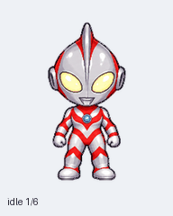

# 奥特曼桌宠 · Ultraman Desktop Pet

Q 版银红奥特曼同人桌宠，支持 **Windows 10 / 11**。透明背景、9 组动作、16 个看向鼠标的姿势；可以点击、拖动，也可以放在桌面陪你工作。

**[下载安装版](https://github.com/412ccc/ultraman-desktop-pet/releases/download/v1.0.0/UltramanPet-Setup-1.0.0.exe)** · **[下载免安装 ZIP](https://github.com/412ccc/ultraman-desktop-pet/releases/download/v1.0.0/UltramanPet-Portable-1.0.0.zip)** · [发布与校验文件](https://github.com/412ccc/ultraman-desktop-pet/releases/latest)

安装版打开后点击“安装”；免安装版解压后双击 `UltramanPet.exe`。运行时无需 ChatGPT、Python 或联网。程序使用 Windows 自带的 .NET Framework 4.x，只安装到当前用户，无需管理员权限。发布文件未做数字签名，Windows 可能显示未知发布者。



## 鼠标互动

| 操作 | 反应 |
| --- | --- |
| 鼠标靠近 | 挥手打招呼，随后转头看向鼠标 |
| 单击 | 跳跃 |
| 双击 | 挥手 |
| 按住左键拖动 | 移动到喜欢的位置 |
| 右键 | 播放九种动作、调整大小、开关鼠标追踪与自动走动、退出 |
| 托盘图标右键 | 打开相同菜单；双击图标可找回桌宠 |

位置和大小在下次启动时恢复。默认不开机自启、不开启自动走动。卸载前先退出桌宠，再从 Windows“已安装的应用”卸载，或运行安装目录中的 `Uninstall.exe`。卸载保留位置设置。详见 [Windows 使用与开发说明](windows/README.md)。

## 图集与网页预览

下载仓库后，直接在浏览器打开 [`index.html`](index.html)。切换动作，或把鼠标移到预览区域内，查看角色转头；点击角色会挥手。网页完全离线运行，没有外部依赖或追踪代码。

| 文件 | 用途 |
| --- | --- |
| [`assets/ultraman-spritesheet.png`](assets/ultraman-spritesheet.png) | 最终 RGBA 透明 PNG 图集 |
| [`assets/pet-metadata.json`](assets/pet-metadata.json) | 可移植布局、动作帧数和鼠标方向定义 |
| [`docs/previews/`](docs/previews/) | 九组 GIF、综合 GIF/MP4、鼠标方向和静态证明图 |
| [`windows/`](windows/) | 独立桌宠及安装器的 C# 源码、测试、使用说明 |
| [`tools/build_windows.py`](tools/build_windows.py) | 编译、测试并生成安装版和免安装版 |
| [`docs/import.md`](docs/import.md) | 在其他宿主中导入与接入图集 |
| [`docs/quality-summary.md`](docs/quality-summary.md) | 图集检查与已知限制 |

## 布局

图集为 **1536 × 2288 px**，8 列 × 11 行，每格 **192 × 208 px**。下表的行号、列号均从 0 开始；每组动作的有效帧从第 0 列向右排列，其余格子保持透明。

| 行 | 状态名 | 动作 | 帧数 |
| --- | --- | --- | --- |
| 0 | `idle` | 待机 | 6 |
| 1 | `running-right` | 向右跑 | 8 |
| 2 | `running-left` | 向左跑 | 8 |
| 3 | `waving` | 挥手 | 4 |
| 4 | `jumping` | 跳跃 | 5 |
| 5 | `failed` | 失落 | 8 |
| 6 | `waiting` | 等待回应 | 6 |
| 7 | `running` | 思考工作 | 6 |
| 8 | `review` | 检查结果 | 6 |
| 9–10 | `look` | 看向鼠标 | 16 |

鼠标方向以屏幕上方为 0°，顺时针每 22.5° 一个姿势：90° 向右、180° 向下、270° 向左。第 9 行为 0°–157.5°，第 10 行为 180°–337.5°。鼠标接近中心时使用第 0 行第 0 列的中立姿势。

## 素材工具

需要 Python 3.10+；只有 Pillow 是第三方依赖。

```sh
python -m pip install -r requirements.txt
python tools/extract_frames.py
python tools/export_previews.py
python tools/validate_pack.py
python -m unittest discover -s tests
```

工具将 73 个格子原样提取到 `build/frames/`，并在 `build/previews/` 导出九组动作 GIF 和鼠标方向 GIF。原始 PNG 不会被修改。预览使用浅色背景；逐帧 PNG 保留透明通道。使用 `--help` 查看输出目录和播放速度选项。

在 Windows 上执行 `python tools/build_windows.py` 可编译程序，运行 171 项检查，并在 `dist/` 输出安装 EXE、免安装 ZIP 与 SHA-256 校验文件。构建依赖和检查范围见 [Windows 开发说明](windows/README.md)。

## 许可与角色权利

项目原创的桌宠程序、安装器、测试、工具和网页代码采用 [MIT License](LICENSE)。**角色图片、图集、内嵌图标和 GIF/MP4 等衍生预览不在 MIT 授权范围内**；请阅读 [素材与第三方权利说明](ASSET_TERMS.md)。奥特曼角色、名称与商标的权利归相应权利人，本项目不声称获得其授权，也不声称与官方有关联。

---

## English

A standalone, transparent **Windows 10/11 desktop pet** with nine animation states and sixteen cursor-facing poses. Download the installer or portable ZIP above. Hover nearby to greet/look, click to jump, double-click to wave, drag to move, and right-click for actions, size and exit. It runs offline with .NET Framework 4.x; Python and ChatGPT are not needed. Binaries are unsigned. The installer operates only on the current user's account. Automatic startup and automatic walking are off by default.

The repository also includes a transparent atlas compatible with the ChatGPT Work custom Pets v2 layout, animation proofs and an offline browser preview. Open `index.html` locally to preview states and cursor tracking. For integration with other hosts, see [import notes](docs/import.md). The atlas is 1536 × 2288 px, arranged as 8 columns and 11 rows with 192 × 208 px cells. It contains 57 animation frames and 16 look poses. Look angles start at screen-up (0°) and progress clockwise in 22.5° steps. See [Windows source/build notes](windows/README.md) for compiling and testing the standalone app.

The original app, installer, tests, helper scripts and preview code are MIT-licensed. Artwork, embedded artwork/icons and derived previews are excluded from MIT; Ultraman character and trademark rights remain with their respective holders. No third-party permission, official endorsement, or affiliation is claimed. See [asset terms](ASSET_TERMS.md) and the [quality summary](docs/quality-summary.md).
